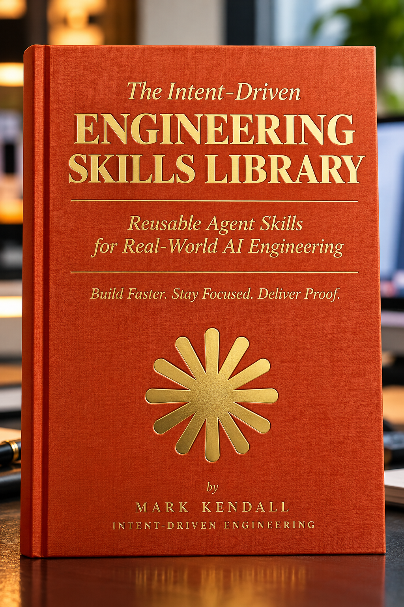

# Intent-Driven Engineering Skills Library

<p align="center">
  
</p>

Reusable Agent Skills for building software from intent, evidence, and governed iteration.

> **Core idea:** State the minimum sufficient intent, build, observe evidence, and add only the next justified delta.

The library is intentionally small. It does not try to encode every engineering activity. It packages the few reusable reasoning capabilities that help an AI engineering agent avoid over-specification, implementation drift, and endless coding.

## Skills included

| Skill | Purpose |
|---|---|
| `intent-refiner` | Turns a rough requirement into a clear intent without prescribing unnecessary implementation. |
| `progressive-intent` | Reads the current intent, implementation results, tests, and evidence; proposes the minimum sufficient next intent until success criteria are met. |
| `evidence-to-intent` | Converts observed evidence into only the justified intent changes. |
| `intent-completion-check` | Decides `DONE`, `NOT_DONE`, or `BLOCKED` against success criteria and evidence. |
| `intent-drift-check` | Detects speculative features, premature architecture, invented constraints, and other drift beyond human intent. |
| `enterprise-radius-review` | Reviews ownership and production readiness across the five Radius levels. |
| `proof-case-study-builder` | Turns completed work into an evidence-grounded case study using Observed, Measured, and Proposed claims. |

## The Progressive Intent loop

```text
Human Intent V1
      |
      v
Implement / Change
      |
      v
Tests + Observation + Evidence
      |
      v
Completion Check --------------------> DONE
      |
      | NOT_DONE
      v
Progressive Intent
(minimum justified delta only)
      |
      v
Intent V2 -> Build -> Test -> Evidence -> ...
```

**Hard rule:** No new intent without new evidence.

**Stop rule:** If the original success criteria are satisfied with sufficient evidence, stop. Do not invent another iteration.

## Quick install — Claude Code

Project-scoped installation is already in the correct layout:

```text
.claude/skills/<skill-name>/SKILL.md
```

Clone or unzip this repository at your project root, or copy the skill folders into an existing project's `.claude/skills/` directory. Claude Code discovers project skills automatically.

For personal/global use, copy the desired folders to:

```bash
~/.claude/skills/
```

See [INSTALL.md](INSTALL.md) for Claude Code and Claude.ai instructions.

## How to use it

You can invoke the skills naturally. Examples:

```text
Give me the intent for this feature.

Use Progressive Intent. Read the current intent, tests, and evidence and tell me the smallest next intent.

Are we done, or is another iteration justified?

Check this implementation for intent drift.

Turn these test failures into the next intent, but don't add anything unsupported by the evidence.
```

See [HOW-TO.md](HOW-TO.md) for a complete feature walkthrough.

## Design principles

1. **Minimum sufficient constraint** — constrain what matters; leave implementation choices open unless ordering, safety, side effects, or recovery require prescription.
2. **Evidence before expansion** — observed results justify the next delta.
3. **Progressive disclosure** — skill metadata stays small; deeper guidance is read only when needed.
4. **Goal-oriented by default** — procedural instructions are reserved for deterministic gates and necessary sequencing.
5. **Human declares; agent reasons; system verifies** — preserve authority boundaries.
6. **Stop when done** — successful agents need explicit completion conditions.
7. **Proof over claims** — separate observed facts, measured results, and proposed conclusions.
8. **Governed capability** — Skills are executable instructions and belong inside the repository trust boundary.

## Repository structure

```text
.claude/skills/                 # Auto-discovered project Skills
  intent-refiner/
  progressive-intent/
  evidence-to-intent/
  intent-completion-check/
  intent-drift-check/
  enterprise-radius-review/
  proof-case-study-builder/
docs/                           # Library-level guidance
evals/                          # Representative skill evaluations
scripts/                        # Packaging / validation helpers
dist/                           # Individual skill ZIPs generated for upload
INSTALL.md
HOW-TO.md
CLAUDE.md
```

## Packaging individual skills

Run:

```bash
./scripts/package-skills.sh
```

This creates one uploadable ZIP per skill in `dist/`. Each ZIP contains the skill directory as its top-level folder.

## Validate the library

Run:

```bash
python scripts/validate_skills.py
```

The validator checks folder/name alignment, required YAML frontmatter, naming rules, description length, file references, and `SKILL.md` size.

## Philosophy

This library is deliberately not a catalog of hundreds of prompts.

> **Don't build 100 Skills. Build the minimum set of capabilities that changes how the agent works.**

The goal is not to spend more tokens describing a future that may never happen. The goal is to give the agent enough intent to act, enough evidence to learn, and enough governance to know when to stop.

## License

MIT. See [LICENSE](LICENSE).
